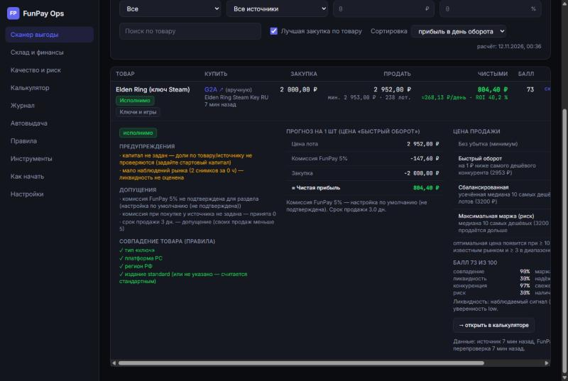
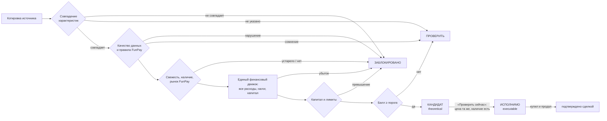
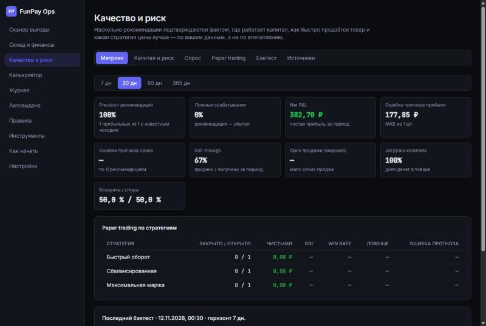

# FunPay Ops 2.2

Система поддержки торговых решений для продавца FunPay. Порядок работы:
1. Проверить данные.
2. Посчитать экономику сделки одним финансовым движком.
3. Подтвердить, что сделку можно исполнить.
4. Измерить, насколько рекомендации подтвердились фактом.



- **Что делать (Decision Center)** — стартовая страница: конкретные действия по приоритету и эффекту в рублях — что купить сейчас, что перепроверить, где склад теряет деньги, какую комиссию подтвердить. То же — командой `/todo` в Telegram.
- **Сканер выгоды** — 68 источников цен (22 автоматических, 46 ручных). Товары сопоставляются по обязательным характеристикам, у каждой цены проверяются свежесть и качество данных, в расчёте учтены все расходы. Статусы: «исполнимо», «кандидат», «проверить», «заблокировано» — у каждой связки есть причины.
- **Profit Verification** — перед покупкой связка перепроверяется: свежая цена мимо кэша **и** подтверждённое наличие. Исход — «успех», «неполная» (цена ок, наличие не подтверждено), «не прошла» или «нет в наличии». Купить можно только «исполнимую» связку.
- **Рынок** — история цен, тренды за 1 ч / 24 ч / 7 / 30 дн, предложение, конкуренты, сигналы ликвидности, аномалии.
- **Склад и финансы** — партии, FIFO или средняя себестоимость, продажи с фактической прибылью, возвраты, частичная поставка, резерв, касса, симуляция.
- **Качество и риск:**
  - precision рекомендаций, ложные срабатывания, ошибка прогноза;
  - вероятность продажи за 1/3/7/14 дней по своим продажам;
  - лимиты доли капитала, старение запасов, прогноз денежного потока;
  - paper trading и бэктест на **исторических параметрах** с реалистичной симуляцией (вероятность продажи, задержка поставки, бюджет, возвраты) и воспроизводимыми прогонами;
  - **политики качества источников** по интервалам Уилсона: испытательный срок, сужение лимитов, буфер маржи, блокировка — в том числе по категории товара.
- **Надёжность:**
  - SQLite с миграциями;
  - бэкапы с тестом восстановления, шифрование AES-256-GCM, внешняя папка и еженедельные учения по восстановлению;
  - мониторинг источников, метрики и журнал ошибок API;
  - журнал действий;
  - идемпотентные операции;
  - постоянные сессии с отзывом (серверный режим);
  - CI;
  - 214 автотестов и E2E полного торгового цикла в браузере (Playwright, 11 шагов).
- **Telegram** — уведомления и команды.
- **Калькулятор, журнал, автовыдача, правила FunPay, справочники.**

Аккаунт FunPay, `golden_key` и пароли инструменту не нужны: он читает только публичные страницы и открытые API и ничего не делает на FunPay от вашего имени. По умолчанию работает на вашем компьютере; для круглосуточной работы есть [серверный режим](docs/DEPLOY.md).

> ⚠️ Рекомендация — проверенная гипотеза, а не гарантия прибыли. Цена объявления ≠ цена продажи; исчезновение лота ≠ продажа; одинаковое название ≠ одинаковый товар.

**Документы:** [CHANGELOG](CHANGELOG.md) · [Релизы](https://github.com/KEN22854/funpay-ops/releases) · [Работа на сервере (VPS)](docs/DEPLOY.md) · [Миграции базы](docs/MIGRATIONS.md)

---

## Содержание

1. [Установка с нуля (Windows)](#1-установка-с-нуля-windows)
2. [Запуск](#2-запуск)
3. [Первые шаги](#3-первые-шаги)
4. [Сканер выгоды](#4-сканер-выгоды)
5. [Склад и финансы](#5-склад-и-финансы)
6. [Настройки сервера: бэкапы, Telegram, диагностика](#6-настройки-сервера-бэкапы-telegram-диагностика)
7. [Калькулятор, журнал, автовыдача, справочники](#7-калькулятор-журнал-автовыдача-справочники)
8. [Все источники (68)](#8-все-источники-68)
9. [Качество и риск](#9-качество-и-риск)
10. [Безопасное использование](#10-безопасное-использование)
11. [Данные и защита](#11-данные-и-защита)
12. [Решение проблем](#12-решение-проблем)
13. [Для разработчика](#13-для-разработчика)
14. [Соответствие аудиту и что не сделано](#14-соответствие-аудиту-и-что-не-сделано)

---

## 1. Установка с нуля (Windows)

1. **Node.js 22.13 или новее** (встроенный SQLite без флагов; проверено на 24.x): https://nodejs.org → версия LTS → установка по умолчанию. Проверьте:

   ```bash
   node -v
   ```

2. **Git**: https://git-scm.com/download/win → установка по умолчанию.
3. **Скачайте проект.** Если репозиторий закрыт (приватный), при первом клонировании Git откроет вход в GitHub.

   ```bash
   git clone https://github.com/KEN22854/funpay-ops.git
   ```

   ```bash
   cd funpay-ops
   ```

4. **Установите зависимости:**

   ```bash
   npm install
   ```

## 2. Запуск

```bash
npm run dev
```

Откройте **http://127.0.0.1:5180**. Поднимаются интерфейс (порт 5180) и сервер (порт 5181). Остановить — `Ctrl + C`. Сканирование, автоскан, уведомления, paper trading и бэкапы работают, пока открыто это окно.

| Команда | Что делает |
|---|---|
| `npm run dev` | интерфейс + сервер, повседневная работа |
| `npm run dev -- --data D:\sandbox` | **песочница**: отдельная база в указанной папке — пробовать, не трогая основные данные |
| `npm start` | сборка + один сервер, который сам раздаёт интерфейс на http://127.0.0.1:5181 |
| `npm run server` | только сервер |
| `npm test` | 214 автотестов: расчёты, паритет финансов, сопоставление, перепроверка, политики источников, бэктест, Decision Center, адаптеры на фикстурах, склад, идемпотентность, шифрование, аварии, защита API |
| `npm run e2e` | сборка + E2E в браузере: полный торговый цикл на детерминированной «сети» (нужен `npx playwright install chromium --only-shell`) |
| `npm run db:check` | проверка миграций и восстановления на **копии** вашей базы |
| `npm run build` | проверка типов + сборка |

**Обновление.** Миграции базы применяются сами при запуске. Перед обновлением полезно выполнить `npm run db:check` (подробнее — [MIGRATIONS](docs/MIGRATIONS.md)). Данные версии 1.x (`data/state.json`) переносятся автоматически; старый журнал сделок — кнопкой «Импорт из старого журнала» в «Склад и финансы → Продажи».

## 3. Первые шаги

Приложение открывается на странице **«Что делать»**: она сама подскажет, чего не хватает (капитал, комиссия раздела, скан) и какие сделки ждут действий. Пункты ниже — то же самое по порядку.

1. **Комиссии.** «Сканер выгоды → Комиссии»: добавьте реальную ставку FunPay для вашего раздела (она видна в форме создания лота).
   - Источник ставки обязателен.
   - Без ставки расчёт помечается как допущение.
   - Ставки из заголовков разделов FunPay («комиссия 2%») записываются автоматически.
2. **Модель.** «Параметры»:
   - комиссия из цены или сверху (сверьте на своём лоте);
   - вывод;
   - спред курса;
   - налог;
   - споры;
   - время.
3. **Капитал.** «Настройки → Склад и капитал»: стартовый капитал и лимиты доли на товар, источник и категорию. Без капитала лимиты не проверяются.
4. **Каталог.** «Каталог → + Товар»:
   - запрос;
   - **обязательные характеристики** (платформа, регионы, тип, издание; для скинов — фаза и диапазон float);
   - раздел FunPay и **его фильтры**.
5. **Скан.** «Сохранить и сканировать». У каждого предложения статус «совпадает», «проверить» или «не совпадает» с причинами. «✓ тот» и «✕ не тот» сохраняют ваше решение.
6. **Кандидаты.** «Возможности → Кандидат» — связки, прошедшие все проверки по котировкам. Нажмите **«Проверить сейчас»**: откройте страницу товара, отметьте «товар в наличии» (для ручных источников — введите цену, которую видите). Связка станет **«Исполнимо»** только при подтверждённых **и цене, и наличии**. Если источник сам сообщил «0 в наличии» — связка блокируется, даже если отметить наличие вручную.
7. **Покупка.** «купил»: партия попадёт на склад, привяжется к рекомендации, а фактическая цена пойдёт в точность источника. Не получилось — «не вышло».
8. **Продажа.** Внесите продажу в «Склад и финансы». Себестоимость спишется с партии, а precision и ошибка прогноза в «Качество и риск» обновятся.

**Быстрый старт для скинов:** «Автопоиск скинов» → CS2 → «Запустить». В строгом режиме (по умолчанию) каждую пару нужно подтвердить вручную — см. 4.2.

---

## 4. Сканер выгоды

### 4.1. Как связка становится рекомендацией



**Жёсткие блоки** — независимо от балла:

| Блок | Когда |
|---|---|
| Товар не совпадает | Несовпадение обязательной характеристики: регион, платформа, тип, издание, фаза, float, ограничение активации |
| Правила FunPay | Однозначное нарушение (п. 2.2.1, 2.2.10, 2.1.1 и др.) |
| Устаревшие данные | Цена источника или FunPay старше допустимого срока (по умолчанию 2 ч / 1 ч, ручные — 24 ч) |
| Нет в наличии | Источник сообщает «0» |
| Нет рынка | На FunPay нет подходящих лотов |
| Убыток | Чистая прибыль ≤ 0 при консервативной цене |
| Капитал | Сделка больше лимита, свободных денег (с учётом резерва) или доли капитала на товар/источник/категорию |
| Перепроверка не прошла | Цена выросла сверх допуска (2 %) или товара нет |
| Источник отключён | 3 ошибки подряд → пауза 15 минут |

**«Проверить»** — характеристика не указана у продавца, проблемы качества данных котировки, предупреждение по правилам, закупка дешевле 25 % цены FunPay (почти всегда не тот товар) или балл ниже порога.

**«Кандидат» → «Исполнимо».** Котировки — ещё не сделка. Кандидат становится исполнимым после перепроверки:
- свежая цена (мимо кэша) не выросла сверх допуска;
- наличие подтверждено — источником или вами на сайте.

Перепроверка действует 15 минут.

**Балл 0–100.** Стартовые веса из аудита — их нужно калибровать на своих сделках (вкладка «Параметры»):

| Компонент | Вес |
|---|---|
| совпадение | 25 |
| маржа | 20 |
| ликвидность | 15 |
| надёжность источника (транспорт × точность цены × точность остатка) | 10 |
| конкуренция | 10 |
| свежесть | 10 |
| риск | 5 |
| наличие | 5 |

**Ранжирование** по умолчанию — по **ожидаемой прибыли в день оборота**, а не по проценту маржи.

### 4.2. Сопоставление товаров

- **Из названия предложения** извлекаются:
  - платформа;
  - регионы;
  - тип (ключ, подарок, аккаунт, аренда, оффлайн, пополнение);
  - издание;
  - признаки DLC и наборов «A + B»;
  - **ограничения активации** («нужен VPN», «не активируется в РФ» — при нужном регионе РФ/СНГ это отказ).
- **У лотов FunPay** используются их структурированные фильтры. **Невыбранные варианты из фильтров раздела** отклоняют другие издания и DLC у источника.
- **Скины** — точный `market_hash_name`. Фаза Doppler сверяется: её передаёт Skinport. Диапазон float сверяется у лотов FunPay, где он указан.
- **Русский и английский.** Словоформы («ключи», «подарком», «для Турции», «турецкий», «Расширенное издание», «Полное издание», «Плейстейшн») распознаются так же, как английские. Русские названия износа скинов («После полевых испытаний») приравниваются к английским.
- **Номер части серии.** «Dying Light» ≠ «Dying Light 2»: другой номер — отказ, номер не указан — на проверку. Годы (2077), «PS5», «4K» и количества («3 месяца», «1000 V-Bucks») номером не считаются.
- **Срок подписки** («1 месяц», «12 months», «1 год») сверяется с карточкой: другой срок — отказ.
- **Схемы категорий.** Для каждой категории задано, что определяет «тот же товар» (ключи — тип, платформа, регион; подписки — срок и регион; валюта — сервер). Форма карточки подсказывает, какие поля не заполнены.
- **Скины: paint seed и наклейки.** В карточке можно задать допустимые paint seed (например, blue gem) и обязательные наклейки. Они читаются из описания лота («Pattern: 661», «Stickers: …», «без наклеек»): другой seed или нет наклейки — отказ.
- **Строгий режим** (по умолчанию). float, paint seed, паттерн и наклейки площадки-источники обычно не передают, поэтому такая пара скинов подтверждается вручную. Если источник передал все три — подтверждать не нужно. Смягчить до «только скины, где цена зависит от фазы/паттерна» — в «Параметрах».
- **Ручное решение** («✓ тот» / «✕ не тот») имеет приоритет и сохраняется.

### 4.3. Единый финансовый движок

Калькулятор, журнал, сканер, склад, paper trading и бэктест считают **одним кодом** (`shared/finance.mjs`). Тест паритета прогоняет 300 случайных сделок через все пути.

```
цена лота P
− комиссия FunPay       (профиль раздела на дату; «из цены» P×X или «сверху» P−P/(1+X))
− вывод                 (с остатка после комиссии — X и Y перемножаются)
− закупка               (цена источника × курс ЦБ × (1 + спред))
− комиссия при покупке  (профиль источника: % + фикс.)
− исполнение            (минуты × ставка часа + прочие расходы)
− споры и возвраты      (обучено по вашим продажам по источнику/категории, сглажено к параметру)
− стоимость капитала    (закупка × % годовых × срок продажи / 365)
− налог                 (с выплаты или с прибыли)
= чистая прибыль;  ROI = прибыль / (закупка + комиссия при покупке)
```

**Срок продажи** берётся по приоритету:
1. вероятность продажи по своим продажам (если их достаточно);
2. медиана своих продаж (если их не меньше минимума);
3. иначе — допущение из параметров, с явной пометкой.

**Цены продажи:**
- минимальная без убытка;
- быстрый оборот — решение принимается по ней;
- сбалансированная;
- максимальная маржа;
- **оптимальная по вашим продажам** — появляется, когда своих продаж с известным рынком ≥ 10 и в диапазоне ≥ 3.

### 4.4. Вкладки

| Вкладка | Что там |
|---|---|
| Возможности | Исполнимо / Кандидат / Проверить / Заблокировано, разбор, «Проверить сейчас», «купил», «не вышло» |
| Рынок | Тренды, предложение (дефицит), конкуренты, спрос-сигнал, недооценённые, аномалии; график истории |
| Каталог | Карточки, характеристики, фильтры FunPay, ручные цены (регион, тип, наличие), разбор совпадений |
| Автопоиск скинов | CS2 / Dota 2 / Rust: весь раздел FunPay против выгрузок площадок |
| Источники | Транспорт: успешность, задержка, классы ошибок, «пустые ответы подряд», отключение |
| Комиссии | Профили ставок с источником, датой начала и историей |
| Параметры | Модель затрат, цены, свежесть, веса балла, исполнимость, строгость, спрос, paper trading; история изменений |

### 4.5. Ликвидность — что это и чем не является

- **Факт — основной сигнал.** Ваши продажи: вероятность продажи за 1/3/7/14 дней с 95 % интервалом. Считается методом Каплана–Мейера: непроданные остатки — «ещё не продано», поэтому залежалый товар не завышает скорость.
- **Наблюдаемый сигнал.** Число лотов, продавцы, исчезновение лотов (только между сопоставимыми сканами), волатильность. Используется с поправкой на уверенность. Пока снимков меньше минимума (6 за 24 ч), ликвидность не оценивается.
- **Исчезновение лота не считается продажей.**

### 4.6. Нагрузка на сайты

- **Кэш:** FunPay — 5 мин, выгрузки — 15 мин, Steam Market — 30 мин.
- **Паузы между запросами** к одному сайту: FunPay — 2 с, Steam — 3,5 с, Skinport — 40 с, остальные — 1,2 с.
- **Повторы** при 429, 5xx и ошибках сети — с нарастающей паузой, `Retry-After` учитывается.
- **Адаптивный интервал:** если цена товара не меняется, он сканируется реже.
- **Перепроверка** запрашивает мимо кэша только один товар; ограничение — 20 перепроверок в минуту.
- Защиту сайтов (Cloudflare, капчи) сканер **не обходит**.

---

## 5. Склад и финансы

Переключатель **«Реальные деньги / Симуляция»**: в симуляции закупки и продажи ведутся отдельно и не влияют на реальную кассу и отчёты.

| Вкладка | Что делает |
|---|---|
| Остатки | На складе / резерв / доступно / в пути / себестоимость / стоимость; резерв и списание |
| Закупки | Партия: количество, цена, валюта (курс ЦБ + спред), комиссии, «в пути» → «получено» (можно меньше заказанного — частичная поставка, разница за товар возвращается в кассу), отмена нетронутой партии |
| Продажи | Комиссия из профиля раздела на дату продажи, себестоимость по FIFO или средней; возврат (полный / частичный, с возвратом на склад), отметка спора, импорт старого журнала |
| Касса | Внесение / изъятие, все движения денег, экспорт CSV (продажи, закупки, касса) |
| Аналитика | Метрики за 7 / 30 / 90 / 365 дн с прошлым периодом, ABC/XYZ, точность рекомендаций |

**Правила учёта:**
- Остаток **не уходит в минус** без явного разрешения в настройках.
- Касса включается стартовым капиталом. Тогда закупка больше остатка блокируется — это защита от кассового разрыва.
- Ничего не удаляется. Отмена, возврат и списание — это отдельные записи.
- Даты в будущем отклоняются.
- Все финансовые операции идемпотентны: повторное нажатие или сетевой повтор не создаёт вторую закупку или продажу.

**Определения метрик:**
- Gross Profit = выручка − себестоимость проданного.
- Net Profit = после комиссий, вывода, исполнения, возвратов и налога.
- ROI = Net / себестоимость проданного.
- Capital Turnover = себестоимость / средние запасы.
- Precision = прибыльные рекомендации / рекомендации с известным исходом. Исход известен, когда вся купленная по рекомендации партия продана или списана; неизвестный исход не считается ни успехом, ни провалом.
- MAE = средняя ошибка прогноза прибыли на 1 шт.

---

## 6. Настройки сервера: бэкапы, Telegram, диагностика

Страница «Настройки», нижний раздел.

- **Автодиагностика** проверяет:
  - целостность базы;
  - версию схемы;
  - источники и формат их ответов;
  - последний бэкап;
  - свежесть данных;
  - подтверждённые комиссии;
  - Telegram.
- **Склад и капитал:**
  - FIFO или средняя себестоимость;
  - стартовый капитал;
  - лимит одной закупки;
  - порог «мало»;
  - разрешение минуса;
  - границы ABC/XYZ.
- **Telegram:**
  1. Создайте бота у @BotFather и вставьте токен.
  2. Напишите боту `/start` — он ответит вашим chat id.
  3. Добавьте chat id и включите уведомления.

  Токен хранится **только** в `data/secrets.json`: не в базе, не в бэкапах, не в git. Бот отвечает только чатам из списка.
  - **Уведомления:** новая рекомендация (выше порога), связка стала убыточной, падение цены конкурента, источник не отвечает, данные устарели, низкий остаток, сбой бэкапа. Повторы одного и того же события не отправляются.
  - **Команды:** `/start`, `/todo`, `/status`, `/opportunities`, `/profit [дней]`, `/report`, `/market`, `/orders`, `/inventory`, `/alerts`, `/sources`.
- **Бэкапы:**
  - автоматически раз в сутки (настраивается), хранится 14 копий;
  - каждая копия сразу проходит тест восстановления: открывается отдельно, `integrity_check`, сверка строк;
  - восстановление — только после проверки, и текущая база перед ним сама сохраняется в копию;
  - **шифрование:** задайте `FPO_BACKUP_KEY` (16+ символов) — к каждой копии добавится файл `.enc` (AES-256-GCM, ключ из пароля через scrypt). `FPO_BACKUP_EXTERNAL_DIR` — папка облачного диска или флешки для зашифрованных копий. Без ключа копию не открыть — храните его отдельно;
  - **учения по восстановлению** раз в неделю (и кнопкой): последняя копия — зашифрованная, если есть ключ, — расшифровывается и читается отдельно от рабочей базы. Копия со старой схемой считается восстановимой: миграции поднимут её при открытии. Сбой — уведомление в Telegram.
- **API:** число запросов, доля ошибок, p50/p95 по каждому маршруту, журнал ошибок сервера (без тел запросов и секретов).
- **Сессии** (серверный режим): список входов с IP и браузером, «закрыть» и «выйти на других устройствах». Сессии переживают перезапуск: в базе хранится только хэш идентификатора.
- **Журнал действий и уведомлений.**

---

## 7. Калькулятор, журнал, автовыдача, справочники

> Журнал (вкладка «Журнал») — прежний ручной учёт в браузере. Для полного учёта с партиями используйте «Склад и финансы»; старые записи переносятся туда кнопкой «Импорт из старого журнала».

### 7.1. Калькулятор маржи

```
Маржа = P × (1 − X%) × (1 − Y%) − C − R − T
```

- **P** — цена лота (что платит покупатель).
- **X** — комиссия площадки.
- **Y** — эффективная стоимость вывода.
- **C** — закупка.
- **R** — средняя потеря на спорах и возвратах на один заказ.
- **T** — время (минуты × ставка часа).

**X и Y перемножаются, а не складываются:** комиссия площадки берётся с суммы заказа, комиссия вывода — с остатка. Калькулятор показывает, на сколько ошиблись бы при сложении.

Возможности:

- **R тремя способами:** ₽ на заказ; % от цены; доля проигранных споров × доля возврата × выплата.
- **Эффективный Y с фиксированной платой:** `Y = 1 − (S × (1 − p) − F) / S` — фиксированная плата сильнее бьёт по маленьким выводам.
- **Вердикт** — зелёный / жёлтый / красный (порог жёлтого задаётся в настройках).
- **Заказов до окупаемости** стартовых вложений и **заказов в месяц** для цели по прибыли.
- **«Какую цену ставить»** — обратный расчёт:
  - минимальная цена (маржа = 0);
  - цена под целевой % маржи;
  - цена под целевые ₽ с заказа;
  - потолок маржи при ваших комиссиях.

  Цены округляются вверх до копейки, поэтому цель выполняется гарантированно.
- Сохранение расчётов с названием товара.

---

### 7.2. Журнал сделок

Ручной учёт продаж. Для каждой сделки: дата, товар, количество, закупка и продажа (суммы за всю сделку), комиссия, вывод, исход спора:

| Исход | Итог сделки |
|---|---|
| Без спора | продажа × (1 − комиссия) × (1 − вывод) − закупка |
| Спор выигран | как без спора, но сделка учитывается в доле споров |
| Полный возврат | −закупка (деньги вернулись покупателю, товар уже выдан) |
| Частичный возврат | как без спора минус указанная потеря |

Что ещё есть в журнале:

- Периоды: 7 / 30 дней, этот / прошлый месяц.
- Сводка: оборот, комиссии, закупка, чистая маржа, доля споров.
- Таблица и график по товарам; убыточные товары подсвечены красным.
- **«→ расчёт»** у товара переносит в калькулятор реальные средние цифры на 1 шт, включая фактическую потерю на спорах (R).
- Редактирование и удаление сделок, экспорт и импорт CSV (разделитель `;`, дубли при импорте пропускаются).

---

### 7.3. Автовыдача

- **Пул товаров.** Вставьте список (одна строка = один товар). Инструмент нормализует пробелы, переносы и пустые строки и проверяет:
  - длину ≤ 140 символов;
  - ≤ 6 абзацев (`\n` внутри строки);
  - дубли;
  - лимит 500 товаров на лот.

  Есть кнопки «разбить длинные строки» и «удалить дубли».
- **Сообщение покупателю после оплаты** — шаблон с переменными `{buyer}`, `{order_id}`, `{item}`, предпросмотр и копирование. Инструкции — сюда, а не в поле товаров (п. 2.1.7).
- **Чеклист** перед публикацией лота.
- **Лимиты:** 140 символов, 500 товаров в лоте, 5000 в сутки.
- **«Сколько осталось»** — через сколько дней пул опустеет и когда пополнять с учётом буфера.

---

### 7.4. Правила, инструменты, «Как начать», настройки

- **Правила** — запрещённые товары FunPay (п. 2.2.x) и пункты о сделках (2.1.x) с санкциями и сроками выплаты, поиск. Правила меняются — сверяйтесь с https://funpay.com/rules.
- **Инструменты** — сторонние библиотеки автоматизации (aioFunPayAPI, FunpayBotEngine, FunpayACE, FunPay Cardinal, fpx). У FunPay нет официального API: эти инструменты работают через `golden_key` и могут привести к блокировке.
- **Как начать** — шаги, чтобы стать продавцом.
- **Настройки:**
  - тема;
  - комиссии по умолчанию;
  - порог «жёлтого» вердикта;
  - резервная копия JSON;
  - сброс данных по разделам.


---

## 8. Все источники (68)

- «Автоматически» — цену собирает сервер.
- «CheapShark» — цены западных магазинов через агрегатор (USD, регион США).
- «Вручную» — цену вводите в карточке товара. В примечании сказано, почему нет автосбора; «проверено» значит, что автоматический запрос действительно был отклонён.

Число источников в реестре ≠ число работающих интеграций. Актуальное состояние — во вкладке «Источники».

| Источник | Сайт | Категории | Сбор | Примечание |
|---|---|---|---|---|
| Steam (РФ) | https://store.steampowered.com | ключи | API | цена в Steam для региона RU |
| Plati.market | https://plati.market | ключи, валюта, аккаунты | API | публичный поиск Digiseller; цена без комиссии платёжной системы |
| GOG (РФ) | https://www.gog.com/ru | ключи | API | каталог GOG, цена в рублях |
| GabeStore | https://gabestore.ru | ключи | страница | разбор страницы поиска |
| GamersGate | https://www.gamersgate.com | ключи | CheapShark | цена в USD для региона США через CheapShark; проверь, активируется ли ключ в твоём регионе |
| Green Man Gaming | https://www.greenmangaming.com | ключи | CheapShark | цена в USD для региона США через CheapShark; проверь, активируется ли ключ в твоём регионе |
| Humble Store | https://www.humblebundle.com/store | ключи | CheapShark | цена в USD для региона США через CheapShark; проверь, активируется ли ключ в твоём регионе |
| Ubisoft Store | https://store.ubisoft.com | ключи | CheapShark | цена в USD для региона США через CheapShark; проверь, активируется ли ключ в твоём регионе |
| Fanatical | https://www.fanatical.com | ключи | CheapShark | цена в USD для региона США через CheapShark; проверь, активируется ли ключ в твоём регионе |
| WinGameStore | https://www.wingamestore.com | ключи | CheapShark | цена в USD для региона США через CheapShark; проверь, активируется ли ключ в твоём регионе |
| GameBillet | https://www.gamebillet.com | ключи | CheapShark | цена в USD для региона США через CheapShark; проверь, активируется ли ключ в твоём регионе |
| Epic Games Store | https://store.epicgames.com | ключи | CheapShark | цена в USD для региона США через CheapShark; проверь, активируется ли ключ в твоём регионе |
| Gamesplanet | https://www.gamesplanet.com | ключи | CheapShark | цена в USD для региона США через CheapShark; проверь, активируется ли ключ в твоём регионе |
| IndieGala | https://www.indiegala.com | ключи | CheapShark | цена в USD для региона США через CheapShark; проверь, активируется ли ключ в твоём регионе |
| DreamGame | https://www.dreamgame.com | ключи | CheapShark | цена в USD для региона США через CheapShark; проверь, активируется ли ключ в твоём регионе |
| Steam (США, через CheapShark) | https://store.steampowered.com | ключи | CheapShark | цена в USD для региона США через CheapShark; проверь, активируется ли ключ в твоём регионе |
| GOG (США, через CheapShark) | https://www.gog.com | ключи | CheapShark | цена в USD для региона США через CheapShark; проверь, активируется ли ключ в твоём регионе |
| Skinport | https://skinport.com | скины | выгрузка | публичная выгрузка цен; лимит 8 запросов/5 мин, кэш 15 мин |
| Market.CSGO / Dota2.net / Rust.tm | https://market.csgo.com | скины | выгрузка | публичная выгрузка цен в рублях |
| LIS-SKINS | https://lis-skins.com | скины | выгрузка | публичная выгрузка, цены в USD |
| Waxpeer | https://waxpeer.com | скины | выгрузка | публичная выгрузка, цены в USD |
| Steam Community Market | https://steamcommunity.com/market | скины | API | жёсткий лимит Steam — запрос раз в 3,5 с, кэш 30 мин; деньги остаются в кошельке Steam |
| G2A | https://www.g2a.com | ключи, валюта, аккаунты | вручную | проверено: закрыт Cloudflare/403 для автоматических запросов |
| Eneba | https://www.eneba.com | ключи, валюта | вручную | проверено: закрыт Cloudflare/403 для автоматических запросов |
| Gamivo | https://www.gamivo.com | ключи | вручную | проверено: закрыт Cloudflare/403 для автоматических запросов |
| Instant Gaming | https://www.instant-gaming.com | ключи | вручную | проверено: закрыт Cloudflare/403 для автоматических запросов |
| Kinguin | https://www.kinguin.net | ключи, валюта | вручную | страница поиска рендерится скриптом — автосбор не реализован — нет открытого API, вводи цену вручную |
| K4G | https://k4g.com | ключи | вручную | автосбор не реализован — нет открытого API, вводи цену вручную |
| GGsel | https://ggsel.net | ключи, валюта, аккаунты | вручную | проверено: серверный поиск не учитывает запрос — автосбор не реализован — нет открытого API, вводи цену вручную |
| SteamBuy | https://steambuy.com | ключи | вручную | автосбор не реализован — нет открытого API, вводи цену вручную |
| Zaka-zaka | https://zaka-zaka.com | ключи | вручную | автосбор не реализован — нет открытого API, вводи цену вручную |
| SteamPay | https://steampay.com | ключи | вручную | автосбор не реализован — нет открытого API, вводи цену вручную |
| Игромагаз | https://www.igromagaz.ru | ключи, валюта | вручную | автосбор не реализован — нет открытого API, вводи цену вручную |
| Бука | https://shop.buka.ru | ключи | вручную | автосбор не реализован — нет открытого API, вводи цену вручную |
| Loaded (CDKeys) | https://www.loaded.com | ключи | вручную | автосбор не реализован — нет открытого API, вводи цену вручную |
| Driffle | https://driffle.com | ключи | вручную | автосбор не реализован — нет открытого API, вводи цену вручную |
| HRK Game | https://www.hrkgame.com | ключи | вручную | автосбор не реализован — нет открытого API, вводи цену вручную |
| MMOGA | https://www.mmoga.com | ключи, валюта | вручную | автосбор не реализован — нет открытого API, вводи цену вручную |
| AllKeyShop (агрегатор) | https://www.allkeyshop.com | ключи | вручную | автосбор не реализован — нет открытого API, вводи цену вручную |
| PlayStation Store | https://store.playstation.com | ключи | вручную | автосбор не реализован — нет открытого API, вводи цену вручную |
| Microsoft Store / Xbox | https://www.xbox.com | ключи | вручную | автосбор не реализован — нет открытого API, вводи цену вручную |
| Nintendo eShop | https://www.nintendo.com | ключи | вручную | автосбор не реализован — нет открытого API, вводи цену вручную |
| CSFloat | https://csfloat.com | скины | вручную | проверено: API отвечает 403 без ключа — автосбор не реализован — нет открытого API, вводи цену вручную |
| DMarket | https://dmarket.com | скины | вручную | проверено: публичный эндпоинт отключён (410) — автосбор не реализован — нет открытого API, вводи цену вручную |
| BUFF163 | https://buff.163.com | скины | вручную | требует вход в аккаунт — автосбор не реализован — нет открытого API, вводи цену вручную |
| BitSkins | https://bitskins.com | скины | вручную | проверено: публичная выгрузка пустая — автосбор не реализован — нет открытого API, вводи цену вручную |
| SkinBaron | https://skinbaron.de | скины | вручную | API требует ключ — автосбор не реализован — нет открытого API, вводи цену вручную |
| Tradeit.gg | https://tradeit.gg | скины | вручную | автосбор не реализован — нет открытого API, вводи цену вручную |
| CS.MONEY | https://cs.money | скины | вручную | автосбор не реализован — нет открытого API, вводи цену вручную |
| SkinsMonkey | https://skinsmonkey.com | скины | вручную | автосбор не реализован — нет открытого API, вводи цену вручную |
| White.market | https://white.market | скины | вручную | автосбор не реализован — нет открытого API, вводи цену вручную |
| Avan.market | https://avan.market | скины | вручную | автосбор не реализован — нет открытого API, вводи цену вручную |
| Mannco.store | https://mannco.store | скины | вручную | автосбор не реализован — нет открытого API, вводи цену вручную |
| G2G | https://www.g2g.com | валюта, аккаунты | вручную | страница рендерится скриптом — автосбор не реализован — нет открытого API, вводи цену вручную |
| PlayerAuctions | https://www.playerauctions.com | валюта, аккаунты | вручную | проверено: закрыт Cloudflare/403 для автоматических запросов |
| Eldorado.gg | https://www.eldorado.gg | валюта, аккаунты | вручную | автосбор не реализован — нет открытого API, вводи цену вручную |
| ZeusX | https://zeusx.com | валюта, аккаунты | вручную | проверено: закрыт Cloudflare/403 для автоматических запросов |
| Overgear | https://overgear.com | валюта, аккаунты | вручную | автосбор не реализован — нет открытого API, вводи цену вручную |
| PlayHub | https://playhub.com | валюта, аккаунты | вручную | автосбор не реализован — нет открытого API, вводи цену вручную |
| LootBar | https://lootbar.gg | валюта | вручную | автосбор не реализован — нет открытого API, вводи цену вручную |
| Codashop | https://www.codashop.com | валюта | вручную | официальные пополнения донат-валюты — автосбор не реализован — нет открытого API, вводи цену вручную |
| Midasbuy | https://www.midasbuy.com | валюта | вручную | официальные пополнения (PUBG UC и др.) — автосбор не реализован — нет открытого API, вводи цену вручную |
| SEAGM | https://www.seagm.com | валюта, ключи | вручную | автосбор не реализован — нет открытого API, вводи цену вручную |
| Playerok | https://playerok.com | валюта, аккаунты, ключи, скины | вручную | автосбор не реализован — нет открытого API, вводи цену вручную |
| Starvell | https://starvell.com | валюта, аккаунты, ключи | вручную | автосбор не реализован — нет открытого API, вводи цену вручную |
| LZT Market | https://lzt.market | аккаунты | вручную | автосбор не реализован — нет открытого API, вводи цену вручную |
| EpicNPC | https://www.epicnpc.com | аккаунты | вручную | автосбор не реализован — нет открытого API, вводи цену вручную |
| FunPay (другой раздел) | https://funpay.com | валюта, аккаунты, ключи, скины | вручную | перепродажа внутри FunPay: дешевле в одном разделе/у одного продавца — дороже в другом |

---

---

## 9. Качество и риск



| Вкладка | Что показывает |
|---|---|
| Метрики | Метрики из аудита: precision рекомендаций, доля ложных срабатываний, Net P&L, ошибка прогноза прибыли (MAE) и срока продажи, sell-through, медианный срок продажи, загрузка капитала, возвраты и споры |
| Капитал и риск | Капитал (касса, резерв, товар, в пути); доли по товарам, источникам и категориям против лимитов; старение запасов и замороженный капитал; прогноз денежного потока на 7/14/30 дней; резерв денег под плановые закупки |
| Спрос | Вероятность продажи за 1/3/7/14 дней (по товару или всем продажам) с интервалом; ценовые диапазоны относительно рынка в момент продажи; продажи по дням недели |
| Paper trading | «Бумажные» позиции по каждому кандидату для трёх стратегий цены. Через горизонт (7 дн.) закрываются по рыночной переоценке |
| Бэктест | Воспроизведение истории без заглядывания в будущее: в момент t — только снимки, комиссии **и параметры**, известные на t («исторические»), или сегодняшние параметры на всей истории («текущие»). Реалистичная симуляция: задержка поставки, вероятность продажи только пока цена конкурентна, бюджет, число позиций, возвраты, выход по рынку в конце горизонта. Разбивка по товарам, источникам, категориям и режиму рынка (рост / падение / флэт). Каждый прогон хранит отпечаток входных данных; «повторить» проверяет, что результат воспроизводится |
| Источники | Уровень доверия (надёжный / обычный / испытательный / заблокирован) по границам интервала Уилсона; качество данных котировок; цена в допуске и наличие по вашим попыткам закупки; возвраты и споры по товару источника |

**Как читать:**
- **Precision.** Исход рекомендации известен, только когда вся партия, купленная по ней, продана или списана. Неизвестный исход не считается ни успехом, ни провалом.
- **Paper trading и бэктест** — прокси без риска капиталом: выход по рыночной цене, а не подтверждённая продажа. Используйте их для сравнения стратегий и калибровки порогов до реальных денег.
- **Точность цены и остатка** копится по вашим кнопкам «купил» и «не вышло». Чем больше отметок, тем точнее оценка источника.
- **Политики источников.** Новый источник — на испытательном сроке: лимиты доли капитала и суммы сделки ×0,5, нужна маржа +5 п.п. «Надёжным» источник становится, когда даже пессимистичная (нижняя) граница точности цены и наличия ≥ 85 % и есть свои продажи без проблем. «Заблокирован» — когда даже оптимистичная граница ниже 50 % или возвратов заведомо больше 20 %. Пороги — в «Параметрах».

## 10. Безопасное использование

1. **Закупка — только вручную и только после «Проверить сейчас».** Инструмент не покупает и не выставляет лоты сам; это осознанное ограничение (аудит: не автоматизировать закупку до подтверждённой точности).
2. Перед покупкой откройте обе ссылки — источник и лот FunPay — и сверьте товар, регион, платформу, издание и способ выдачи.
3. Начинайте с малых партий и **режима симуляции**. Смотрите precision и ложные срабатывания в «Качество и риск».
4. Задайте стартовый капитал и **лимиты доли**, чтобы одна связка не забрала все деньги.
5. Внесите **реальную ставку комиссии** раздела и налог — иначе прибыль завышена.
6. Скинам по умолчанию нужно ручное подтверждение: float и наклейки меняют цену.
7. Соблюдайте правила FunPay: перепродажа офлайн-активаций, гифтов и чужих аккаунтов в ряде разделов запрещена («Правила»).
8. Не публикуйте сервер в сеть без `FPO_AUTH_TOKEN` и HTTPS (см. [DEPLOY](docs/DEPLOY.md)).

## 11. Данные и защита

| Что | Где |
|---|---|
| Каталог, история, склад, продажи, касса, комиссии, рекомендации, paper trading, бэктесты, журнал | `data/funpay-ops.db` (SQLite, WAL) |
| Бэкапы | `data/backups/` |
| Токен Telegram | `data/secrets.json` (не в базе, не в бэкапах, не в git) |
| Калькулятор, старый журнал, автовыдача, тема | `localStorage` браузера |

Папка `data/` и файл `.env` в git не попадают.

**Защита:**
- проверка `Host` (защита от DNS rebinding) и `Origin`;
- заголовок `X-FPO-Client` для изменяющих запросов (защита от CSRF);
- `Idempotency-Key`: проверка, операция и запись ключа — одна транзакция;
- лимит тела запроса 1 МБ;
- ограничение частоты дорогих операций;
- ссылки на разделы — только хост `funpay.com` (защита от SSRF);
- журнал действий без секретов;
- в серверном режиме — обязательный ключ доступа, cookie `HttpOnly; SameSite=Strict`, ограничение попыток входа.

## 12. Решение проблем

| Проблема | Что делать |
|---|---|
| «Сервер не отвечает» | Запущен ли `npm run dev`? Окно должно быть открыто |
| `node:sqlite` не найден / требует флаг | Обновите Node.js до 22.13+ |
| `Port 5180 is already in use` | Приложение уже запущено — закройте другое окно или процесс `node` |
| Всё в «Кандидат», ничего «Исполнимо» | Так и задумано: нажмите «Проверить сейчас» перед покупкой |
| Все скины в «Проверить» | Строгий режим; подтвердите пару вручную или смягчите строгость в «Параметрах» |
| Всё «Заблокировано: устарело» | Просканируйте или включите автоскан |
| «доля капитала … станет N%» | Лимит долей; измените в «Настройки → Склад и капитал» |
| «Комиссия FunPay не подтверждена» | Добавьте ставку раздела во вкладке «Комиссии» |
| Продажа «недостаточно остатка» | Сначала закупка (партия), либо разрешите минус в настройках |
| Источник «отключён» | 3 ошибки подряд → пауза 15 мин; причина — во вкладке «Источники» |
| «маржа ниже буфера … испытательный срок» | Новый источник: сделайте пару пробных закупок с отметкой «купил / не вышло» или смягчите политику в «Параметрах» |
| Перепроверка «неполная» | Цена подтвердилась, а наличие — нет: отметьте «товар в наличии», если видите его на сайте |
| Метрики качества пустые | Покупайте через «купил» в сканере — так партия связывается с рекомендацией |
| Нужно вернуть старое состояние | «Настройки → Резервные копии → восстановить» |

## 13. Для разработчика

**Стек:**
- Интерфейс: React 18, Vite 5, TypeScript strict, Tailwind 3, Framer Motion, Recharts, Zustand.
- Сервер: чистый Node.js (`node:http`, `node:sqlite`, `fetch`), без сторонних зависимостей.
- Тесты: Vitest; E2E — Playwright.
- CI: GitHub Actions (Node 22.13 / 22.x / 24.x) + E2E в браузере.

```
shared/finance.mjs     ЕДИНЫЙ финансовый движок (сервер и интерфейс импортируют его)
server/
  index.mjs            API, очередь сканов, уведомления, обслуживание, вход (серверный режим)
  scanner.mjs          скан, качество данных котировок, автопоиск скинов
  opportunities.mjs    сборка возможностей: движок × риск × спрос × качество; журнал рекомендаций, paper trading
  verify.mjs           Profit Verification: перепроверка перед закупкой (таблица исходов decideVerification)
  decisions.mjs        Decision Center: правила «что сделать сейчас»
  core/                attributes (сопоставление), engine (статусы, блоки, балл, цены), compliance, finance (реэкспорт)
  repo/                settings, audit, watches, fees, health, quality, history, demand, risk, paper, backtest,
                       inventory, analytics, metrics, backup
  lib/                 http (кэш, лимиты, повторы, мимо кэша), funpay, match, rates, auth (сессии), ops (метрики API)
  db/                  SQLite, миграции v1–v3, транзакции
  tests/               ядро, БД, модули, сопоставление, Decision Center, ops (шифрование, учения, метрики),
                       паритет финансов, адаптеры на фикстурах, процессы (аварии, конкуренция, вход, сессии)
e2e/                   Playwright: trade-cycle.spec.ts, fake-net.mjs (детерминированная «сеть»)
src/                   интерфейс: pages/scanner/*, Inventory, Quality, settings/ServerAdmin
scripts/               dev.mjs (+ --data), db-check.mjs, sandbox-server.mjs (песочница с фикстурами)
docs/                  DEPLOY, MIGRATIONS, img
```

**Новый источник:**
1. Функция в `server/sources/adapters.mjs` возвращает `{ sourceId, title, price, currency, url, stock? }`; используйте `fetchCached`.
2. Регистрация в `ADAPTERS`.
3. Запись `auto(...)` в `registry.mjs`; заранее известные регион, тип или платформа — в `KNOWN`.
4. Фикстура и тест в `server/tests/adapters.test.mjs`: нормальный ответ, пустой, смена формата.

**Изменение формул** — только в `shared/finance.mjs`; тест паритета должен проходить.

**Миграции** — только новые версии в конце `server/db/migrations.mjs` (см. [MIGRATIONS](docs/MIGRATIONS.md)).

**Релиз:**
1. Запись в [CHANGELOG](CHANGELOG.md).
2. Версия в `package.json` (и `ENGINE_VERSION`, если менялась логика решений).
3. `npm test && npm run db:check && npm run e2e`.
4. Тег `vX.Y.Z`.

## 14. Соответствие аудиту и что не сделано

**Аудит 2026-11-12 (третий):**

| Приоритет | Замечание | Что сделано |
|---|---|---|
| P0 | «Проверить сейчас» засчитывалась без подтверждённого наличия | Успех — только цена **и** наличие; исходы ok / incomplete / failed / blocked; `stock = 0` — блок даже при ручной отметке; тест на каждую строку таблицы аудита |
| P0 | Нет E2E торгового цикла | Playwright: товар → скан → Decision Center → перепроверка → закупка → частичная поставка → продажа (FIFO) → частичный возврат → касса и аналитика → экспорт/импорт → шифрованный бэкап, учения, восстановление; job в CI |
| P0 | Документация расходится с репозиторием | README без утверждения «приватный», LICENSE, релизы на GitHub |
| P1 | Бэктест на текущих параметрах | Исторические параметры и комиссии «как были известны на t»; режим «текущие» отдельно; отпечаток входных данных и проверка воспроизводимости |
| P1 | Упрощённая симуляция | Вероятность продажи, задержка поставки, бюджет, одновременные позиции, возвраты, остатки у источника; разбивка по товару, источнику, категории, режиму рынка |
| P1 | Качество источников только для просмотра | Политики по интервалам Уилсона: испытательный срок, множитель лимитов, буфер маржи, блокировка, по категории |
| P1 | Нет центра решений | Страница «Что делать» и `/todo` в Telegram |
| P1 | Сопоставление RU/EN, схемы, CS2 | Словоформы, номер части, срок подписки, схемы категорий, paint seed и наклейки |
| P2 | Сессии в памяти | Сессии в базе (хэши), срок и простой, список и отзыв |
| P2 | Бэкапы без шифрования | AES-256-GCM, внешняя папка, еженедельные учения |
| P2 | Наблюдаемость | Метрики API (p50/p95, ошибки), журнал ошибок без секретов |

**Обновлённый аудит (ноябрь 2026), критические замечания:**

| Приоритет | Замечание | Что сделано |
|---|---|---|
| P0 | Две финансовые модели | Единый движок `shared/finance.mjs`, тест паритета |
| P0 | Scoring не подтверждён | Журнал рекомендаций с версией движка и параметров, precision/ложные/MAE по фактам, paper trading, бэктест |
| P0 | Technical health ≠ data quality | Отдельно: транспорт, качество данных, точность цены, точность остатка, исполнение |
| P0 | Неполная идентификация CS2 | Строгий режим, фаза, диапазон float; неполные данные не дают авто-рекомендацию |
| P1 | Ликвидность по косвенным сигналам | Свои продажи — основной сигнал (Каплан–Мейер), минимум наблюдений, уверенность |
| P1 | Нет эластичности спроса | Ценовые диапазоны своих продаж; оптимальная цена — только при достаточных данных |
| P1 | Нет учёта капитала | Капитал, резервы, доли, старение запасов, прогноз денежного потока, частичная поставка |
| P1 | Риски возвратов | Потери обучаются по своим сделкам по источнику и категории |
| P1 | README отстаёт / Node | README по фактической структуре; Node ≥ 22.13 везде, CI |
| P2 | 24/7 | Серверный режим с входом, Dockerfile, [DEPLOY](docs/DEPLOY.md) |
| P2 | Релизный процесс | CI, CHANGELOG, политика миграций, теги |

**Пять модулей аудита** реализованы:
- Profit Verification (theoretical / executable / подтверждено сделкой);
- Demand Intelligence;
- Smart Product Matching;
- Capital & Risk Manager;
- Strategy Backtesting (с paper trading и версионированием).

**Чек-лист перед релизом** закрыт тестами:
- сборка и тесты на нужной версии Node;
- адаптеры на фикстурах (пустой ответ, смена формата, 429);
- граничные значения курса и спреда;
- все виды комиссий;
- устаревшая цена, неизвестный остаток и REVIEW_REQUIRED не становятся «исполнимо»;
- возврат, частичный возврат, спор, отмена, частичное исполнение;
- миграции на копии базы (`db:check`) и восстановление;
- конкурентная запись, повтор запроса, аварийное завершение;
- SSRF, лимиты, таймауты, секреты;
- аудит изменений комиссий, настроек и статусов.

**Сознательно не сделано (по разделу 10 аудита):**
- PostgreSQL вместо SQLite — нет многопользовательской нагрузки.
- Автоматическая закупка и действия на FunPay — до подтверждённой точности; к тому же у FunPay нет официального API.
- Новые источники — пока не измерены точность и доступность существующих.

**Требует данных или вашего решения:**
- **Прогноз цен и эластичности с интервалами, AI Analyst, сезонность по событиям** — нужна накопленная история своих продаж. Инструменты сбора уже работают: журнал рекомендаций, paper trading, снимки.
- **Развёртывание 24/7** — подготовлено, но нужен ваш VPS и домен.
- **Sentry / OpenTelemetry** — внешний сервис мониторинга не подключён: метрики и журнал ошибок API, диагностика, здоровье источников и Telegram работают локально.
- **Оценка «помогает зарабатывать»** — никакой софт не гарантирует прибыль. Инструмент отсеивает убыточные и неисполнимые сделки и показывает, где теряются деньги; реальная доходность видна только по вашим сделкам («Качество и риск → Метрики»).

---

## Лицензия

Все права защищены — см. [LICENSE](LICENSE). Код открыт для просмотра; использование, копирование и распространение — только с разрешения автора.
